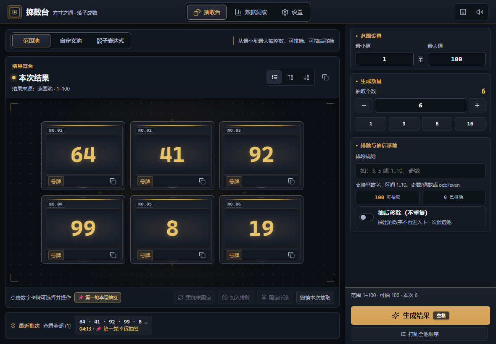

# RandDeck

Draw numbers from a range, pick from your own custom list, or roll polyhedral dice on Windows 11 x64. Runs 100% offline — no accounts, no telemetry, no cloud, and no auto-update.

Chinese name: **掷数台**. 中文说明：[README.zh-CN.md](README.zh-CN.md).



## What it does

- **Three draw modes**: integer ranges, custom number/item pools with optional weights and tags (CSV import/export supported), and tabletop dice expressions like `2d6+3`, `2d20kh1`, or `4d6kh3`.
- **Flexible exclusions**: skip specific numbers, ranges, odds, or evens; turn on **Draw and remove** so drawn numbers won't repeat.
- **Interactive result cards**: click cards to reroll only your selection, pin results across draws, add values to the exclusion rule, or undo the entire draw transaction.
- **Batch notes & search**: attach a quick note to any draw batch (via right-click on Recent Batches or the bottom action bar) and filter by notes in **Data Insights**.
- **Three motion styles**: **Instant** for zero wait, **Standard** for everyday use, or **Ceremony** for live reveals (with `3s`/`5s`/`10s` countdowns, card-by-card reveal, and gold confetti).
- **Detached display window**: open a secondary window in normal view, fullscreen presentation mode for projectors, or a frameless always-on-top transparent overlay.
- **Data Insights & exports**: browse draw history, frequency charts, pool coverage, trends, and exact/simulated probability tables; export JSON, CSV, PNG receipts, or full backups.
- **Themes & scaling**: Dark, Light, and High-Contrast themes with proportional container scaling for high-DPI and maximized screens; instant UI switching between English and Simplified Chinese.
- **Strictly local**: numbers are drawn locally via Web Crypto (animations are purely visual and never alter outcomes).

## Downloads

Grab the latest release from [GitHub Releases](https://github.com/Allserial/randdeck/releases):

- `RandDeck.exe`: single-file portable app. Requires Microsoft Edge WebView2 Runtime (pre-installed on Windows 11).
- `RandDeck-v0.7.3-portable.zip`: portable zip bundle with bilingual docs, project and dependency license reports, manifest, and SHA256 checksums.
- `RandDeck-v0.7.3-offline-setup.exe`: offline installer with bundled WebView2 runtime; upgrades existing v0.5.0 / v0.6.0 / v0.7.0 / v0.7.1 / v0.7.2 installs while keeping local data.

This release is not code-signed, so Windows SmartScreen may show an unknown-publisher prompt. Verify the SHA256 checksum on the release page before running.

## Local development

Prerequisites: Node.js 24 LTS, npm 11, stable Rust, Microsoft C++ Build Tools, and WebView2 Runtime.

```powershell
git clone https://github.com/Allserial/randdeck.git
Set-Location .\randdeck
npm install
npm run dev
```

Dev server runs at `http://localhost:5173/`.

Quality checks:

```powershell
npm run i18n:verify
npm run icons:verify
npm run lint
npm run typecheck
npm run test
npm run test:e2e
npm run build
```

Tauri desktop dev and builds:

```powershell
npm run tauri:dev
npm run tauri:build:offline
npm run tauri:build:portable
```

## Local data & upgrade compatibility

- Desktop state file: `%APPDATA%\com.zhishutai.desktop\state-v5.json`
- Browser dev storage: IndexedDB `zhishutai-v5`
- Backup schema: `zhishutai.backup.v5` (receipts and manifests also keep the `zhishutai.*` namespace)

These internal `zhishutai.*` identifiers are kept intentionally so upgrading from v0.5.0 / v0.6.0 preserves your history and presets. Nothing is ever uploaded. You can export a full JSON backup in **Settings** before moving to a new PC.

## Security

This repository never stores credentials, private keys, local machine paths, or personal records. To report a security issue privately, see [SECURITY.md](SECURITY.md).

## License

Released under the [MIT License](LICENSE). Third-party dependencies retain their respective licenses. Release bundles include `dependencies-licenses.json`: `npmResolved` lists every resolved package location in `package-lock.json`, including transitive, development, optional, and platform-specific packages; `npmDirect` remains a compatibility summary of direct dependencies. Each npm entry records its locked name, version, license, dependency flags, platform constraints, and installation status. `rustResolved` lists the packages returned by locked Cargo metadata. This inventory describes source/build dependencies, rather than claiming that every listed package is embedded in the executable. Missing npm license metadata or conflicts with installed package metadata stop release generation.
